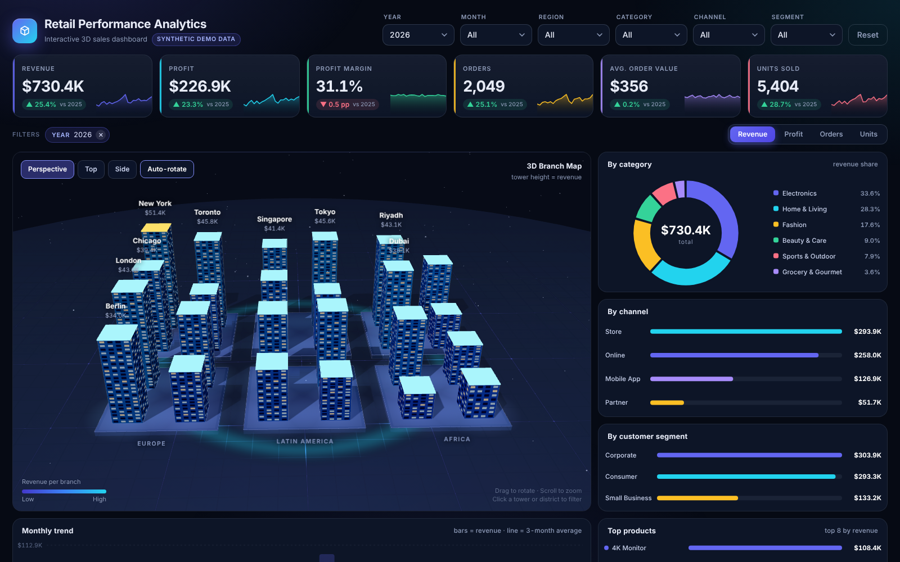

# Retail Performance Analytics — Interactive 3D Dashboard

A single-page, **Power BI-style analytics dashboard with a real-time 3D branch map**, built with vanilla JavaScript and Three.js.
It reads an Excel workbook, bakes the data into one self-contained `index.html`, and can be hosted for free on GitHub Pages.

> All data in this repository is **synthetic** (randomly generated). No real company, customer or employee data is used.



## Highlights

- **3D branch map** — 24 branches as towers on regional districts; height = the selected metric (revenue, profit, orders or units).
  Orbit, zoom, hover tooltips, click-to-filter, camera presets (perspective / top / side), auto-rotate, soft shadows and animated growth.
- **Full cross-filtering** — every chart, KPI, the 3D map and the table react to each other. Click any bar, slice, tower or table row;
  `Ctrl`/`Shift`+click adds to the selection; removable filter chips show what is active.
- **Multi-select filters** — Year, Month, Region, Category, Channel and Segment, with search, *Select all* and *Clear*.
- **KPI strip with year-over-year** — revenue, profit, margin, orders, average order value and units, each with a sparkline and a
  same-months comparison against the previous year.
- **Metric switch** — one click re-draws everything for Revenue, Profit, Orders or Units.
- **Sortable orders table** (all rows, chunk-rendered) with **CSV export** of the current view.
- **Responsive** layout, reduced-motion support, no external requests — works offline.

## Project structure

```
.
├── index.html                  # the built dashboard (single file, GitHub Pages entry point)
├── data/sales_data.xlsx        # the Excel source (synthetic)
├── config.json                 # title, subtitle, author and links shown in the page
├── src/template.html           # dashboard source (HTML + CSS + JS)
├── vendor/                     # three.js r128 + OrbitControls (MIT)
├── scripts/
│   ├── build.py                # Excel -> index.html (Python, openpyxl)
│   ├── generate_data.py        # creates the synthetic workbook
│   └── Update-Data.ps1         # Excel -> index.html on Windows (uses Excel itself)
├── Update-Data.bat             # double-click wrapper for the PowerShell script
├── .github/workflows/build.yml # rebuilds index.html automatically on push
└── docs/                       # screenshots
```

## Run it

Just open `index.html` in a browser — there is nothing to install.

## Publish on GitHub Pages

1. Create a repository and upload (or `git push`) the contents of this folder.
2. **Settings → Pages → Build and deployment → Source: Deploy from a branch**, branch `main`, folder `/ (root)`.
3. After a minute your dashboard is live at `https://<your-username>.github.io/<repository>/`.

Put your name and links in `config.json`, then rebuild (see below):

```json
{
  "title": "Retail Performance Analytics",
  "subtitle": "Interactive 3D sales dashboard",
  "author": "Your Name",
  "github": "https://github.com/your-username",
  "linkedin": "https://www.linkedin.com/in/your-profile"
}
```

## Update the data (three ways)

The dashboard reads **sheet 1** of `data/sales_data.xlsx` (columns can be in any order, headers in row 1):

| Column | Type | Example |
|---|---|---|
| Order ID | text | ORD-100001 |
| Order Date | date | 2026-03-14 |
| Region / Branch | text | Middle East / Dubai |
| Category / Product | text | Electronics / Smart Watch |
| Channel | text | Online |
| Segment | text | Corporate |
| Units | number | 3 |
| Revenue / Cost | number | 747.00 / 523.10 |

Profit is calculated by the dashboard (`Revenue − Cost`).

**1. Windows + Excel (no Python needed).** Edit and save the workbook, then double-click **`Update-Data.bat`**.
It opens the workbook read-only through Excel, rewrites only the data block inside `index.html` and prints `updated: N orders`.

**2. Python (any OS).**
```bash
pip install openpyxl
python scripts/build.py
```

**3. Automatically on GitHub.** Commit the changed Excel file to `main`; the workflow in `.github/workflows/build.yml`
rebuilds `index.html` and commits it back, so GitHub Pages always shows the latest numbers.

Want fresh sample data? `python scripts/generate_data.py 8000` creates a new random workbook with 8,000 orders.

## Make it your own

- **Another topic** (tickets, projects, inventory…): keep the same 11 columns, or edit the field list in `scripts/build.py`
  and the row mapping at the top of the script in `src/template.html`.
- **Colors**: CSS variables at the top of `src/template.html` (`--ind`, `--cy`, `--am` …) and the palettes in the JS.
- **3D layout**: the `GAP`, `SL`, `TW`, `HMAX` constants in `init3D()` control district spacing, tower width and maximum height.

## How it works

1. `build.py` (or the PowerShell script) turns the Excel rows into compact JSON and injects it into
   `<script id="rawdata" type="application/json">`.
2. At load time the page parses that JSON once and keeps every row in memory.
3. A single filter state (`S`) drives everything: each chart calls `view(skip)` to get the rows that pass the active filters
   (a chart skips its *own* dimension, so selections show as highlights instead of making the chart vanish).
4. The 3D scene (Three.js) is updated from the same aggregates; towers animate toward their new height and colour.

## Tech

Vanilla JavaScript · SVG charts · Three.js r128 (WebGL) · Python (openpyxl) · PowerShell (Excel COM) · GitHub Actions / Pages

## License

MIT — see [LICENSE](LICENSE). three.js is MIT licensed, © three.js authors.
